p8105_hw2_cc5604
================
Changshen Chen
2026-10-18

# Problem 1

## Loading the dataset

``` r
data("ny_noaa")
```

## EDA

``` r
dimension = dim(ny_noaa)
stationcount = n_distinct(ny_noaa$id)
daterange = range(ny_noaa$date)

ny_noaa |>
  summarize(across(everything(), \(x) mean(is.na(x)))) |>
  knitr::kable(digits = 3)
```

|  id | date |  prcp |  snow |  snwd |  tmax |  tmin |
|----:|-----:|------:|------:|------:|------:|------:|
|   0 |    0 | 0.056 | 0.147 | 0.228 | 0.437 | 0.437 |

The ny_noaa dataset has 2595176 rows and 7 columns. It includes the
following variables: id, date, prcp, snow, snwd, tmax, tmin. The data is
from 747 distinct stations with date in the range of 1981-01-01,
2010-12-31. A considerable amount of data is missing. Specifically,
43.7% of tmax and tmin values are not available. In addition, some
proportion of snowfall, snow depth and precipitation data are also
missing.

## Data cleaning

``` r
ny_noaa_df =
  ny_noaa |>
  mutate(
    year = lubridate::year(date),
    month = lubridate::month(date),
    day = lubridate::day(date),
    prcp = prcp / 10,
    tmax = as.numeric(tmax) / 10,
    tmin = as.numeric(tmin) / 10
  )

ny_noaa_df |>
  count(snow, sort = TRUE)
```

    ## # A tibble: 282 × 2
    ##     snow       n
    ##    <int>   <int>
    ##  1     0 2008508
    ##  2    NA  381221
    ##  3    25   31022
    ##  4    13   23095
    ##  5    51   18274
    ##  6    76   10173
    ##  7     8    9962
    ##  8     5    9748
    ##  9    38    9197
    ## 10     3    8790
    ## # ℹ 272 more rows

The most commonly observed snowfall value is 0. This is potentially
because that it does not snow on most days of the year. After 0, the
most common values are NA, 25, 13, and 51 mm.

## Two-panel plot showing the average max temperature in January and in July in each station across years

``` r
ny_noaa_df |>
  filter(month %in% c(1, 7)) |>
  mutate(month = month.name[month]) |>
  group_by(id, year, month) |>
  summarize(mean_tmax = mean(tmax, na.rm = TRUE)) |>
  ggplot(aes(x = year, y = mean_tmax, group = id)) +
  geom_point() +
  geom_line() +
  facet_grid(. ~ month)
```

    ## `summarise()` has regrouped the output.
    ## ℹ Summaries were computed grouped by id, year, and month.
    ## ℹ Output is grouped by id and year.
    ## ℹ Use `summarise(.groups = "drop_last")` to silence this message.
    ## ℹ Use `summarise(.by = c(id, year, month))` for per-operation grouping
    ##   (`?dplyr::dplyr_by`) instead.

    ## Warning: Removed 5970 rows containing missing values or values outside the scale range
    ## (`geom_point()`).

    ## Warning: Removed 5932 rows containing missing values or values outside the scale range
    ## (`geom_line()`).

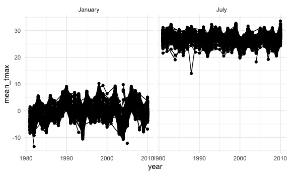

From the plot, the average max temperatures for January and July are
around 0 and 27 degrees respectively. The values varies more in January
than in July. There are two most obvious outliers, with one station
observing about 14 degress in July and another observing about -13
degrees in January.

## Two-panel plot showing tmax vs tmin

``` r
ny_noaa_df |>
  ggplot(aes(x = tmin, y = tmax)) +
  geom_bin2d()
```

    ## `stat_bin2d()` using `bins = 30`. Pick better value `binwidth`.

    ## Warning: Removed 1136276 rows containing non-finite outside the scale range
    ## (`stat_bin2d()`).

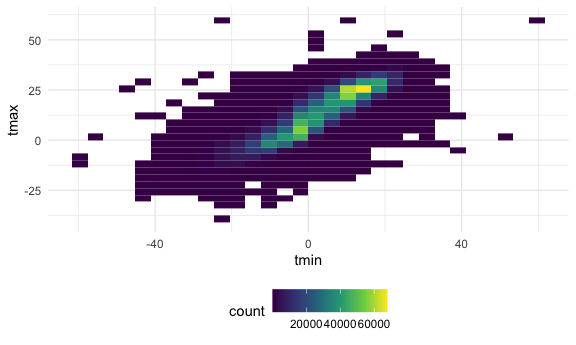

According to the plot, tmax and tmin are positively related. The dense
cluster in the middle suggests that tmax is about 10-15 degress higher
than tmin in most of the days.

## Plot showing the distribution of snowfall values greater than 0 and less than 100 separately by year

``` r
ny_noaa_df |>
  filter(snow > 0, snow < 100) |>
  ggplot(aes(x = factor(year), y = snow)) +
  geom_violin()
```

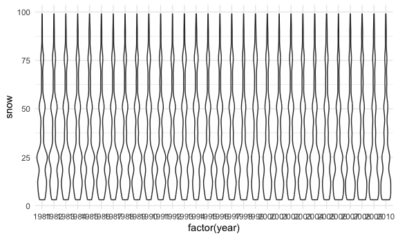

From the plot, the distribution of snowfall values greater than 0 and
less than 100 demonstrate similar trend over the years.

# Problem 2

## Data cleaning and merging

``` r
demo_df = 
  read_csv("data/nhanes_covar.csv", skip = 4) |>
  janitor::clean_names()|>
  filter(age >= 21) |>
  drop_na() |>
  mutate(
    sex = case_match(
      sex, 
      1 ~ "male", 
      2 ~ "female"
      ),
    education = case_match(
      education,
      1 ~ "Less than high school",
      2 ~ "High school equivalent",
      3 ~ "More than high school"
    )
  )
```

    ## Rows: 250 Columns: 5
    ## ── Column specification ────────────────────────────────────────────────────────
    ## Delimiter: ","
    ## dbl (5): SEQN, sex, age, BMI, education
    ## 
    ## ℹ Use `spec()` to retrieve the full column specification for this data.
    ## ℹ Specify the column types or set `show_col_types = FALSE` to quiet this message.

    ## Warning: There was 1 warning in `mutate()`.
    ## ℹ In argument: `sex = case_match(sex, 1 ~ "male", 2 ~ "female")`.
    ## Caused by warning:
    ## ! `case_match()` was deprecated in dplyr 1.2.0.
    ## ℹ Please use `recode_values()` instead.

``` r
acc_df =
  read_csv("data/nhanes_accel.csv") |>
  janitor::clean_names()|>
  pivot_longer(
    min1:min1440,
    names_to = "minute",
    names_prefix = "min",
    values_to = "mims"
  )
```

    ## Rows: 250 Columns: 1441
    ## ── Column specification ────────────────────────────────────────────────────────
    ## Delimiter: ","
    ## dbl (1441): SEQN, min1, min2, min3, min4, min5, min6, min7, min8, min9, min1...
    ## 
    ## ℹ Use `spec()` to retrieve the full column specification for this data.
    ## ℹ Specify the column types or set `show_col_types = FALSE` to quiet this message.

``` r
nhanes_df =
  left_join(demo_df, acc_df, by = "seqn")
```

## Table for the number of men and women in each education category

``` r
demo_df |>
  count(education, sex) |>
  pivot_wider(
    names_from = sex,
    values_from = n
  ) |>
  knitr::kable()
```

| education              | female | male |
|:-----------------------|-------:|-----:|
| High school equivalent |     23 |   35 |
| Less than high school  |     28 |   27 |
| More than high school  |     59 |   56 |

## Age distributions for men and women in each education category

``` r
demo_df |>
  ggplot(aes(x = education, y = age, fill = sex)) +
  geom_boxplot()
```

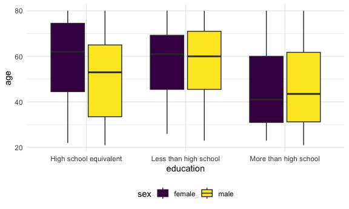

## Creating a total activity variable for each participant

``` r
total_df =
  nhanes_df |>
  group_by(seqn, sex, age, education) |>
  summarize(total_mims = sum(mims))
```

    ## `summarise()` has regrouped the output.
    ## ℹ Summaries were computed grouped by seqn, sex, age, and education.
    ## ℹ Output is grouped by seqn, sex, and age.
    ## ℹ Use `summarise(.groups = "drop_last")` to silence this message.
    ## ℹ Use `summarise(.by = c(seqn, sex, age, education))` for per-operation
    ##   grouping (`?dplyr::dplyr_by`) instead.

## Comparing total activities for “Less than high school” group

``` r
total_df |>
  filter(education == "Less than high school") |>
  ggplot(aes(x = age, y = total_mims, color = sex)) +
  geom_point() +
  geom_smooth(se = FALSE)
```

    ## `geom_smooth()` using method = 'loess' and formula = 'y ~ x'

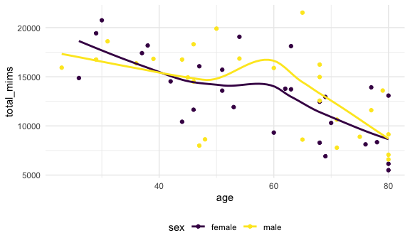

## Comparing total activities for “High school equivalent” group

``` r
total_df |>
  filter(education == "High school equivalent") |>
  ggplot(aes(x = age, y = total_mims, color = sex)) +
  geom_point() +
  geom_smooth(se = FALSE)
```

    ## `geom_smooth()` using method = 'loess' and formula = 'y ~ x'

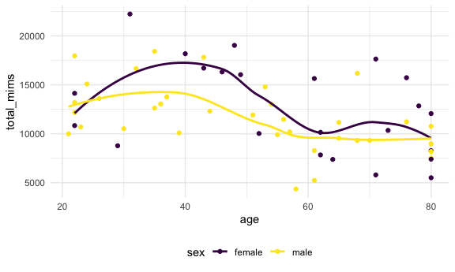

## Comparing total activities for “More than high school” group

``` r
total_df |>
  filter(education == "More than high school") |>
  ggplot(aes(x = age, y = total_mims, color = sex)) +
  geom_point() +
  geom_smooth(se = FALSE)
```

    ## `geom_smooth()` using method = 'loess' and formula = 'y ~ x'

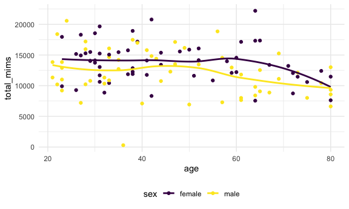

## Three-panel plot that shows the 24-hour activity time courses for “Less than high school” group

``` r
nhanes_df |>
  filter(education == "Less than high school") |>
  ggplot(aes(x = minute, y = mims, color = sex)) +
  geom_line(aes(group = seqn), alpha = .1) +
  geom_smooth(se = FALSE)
```

    ## `geom_smooth()` using method = 'loess' and formula = 'y ~ x'

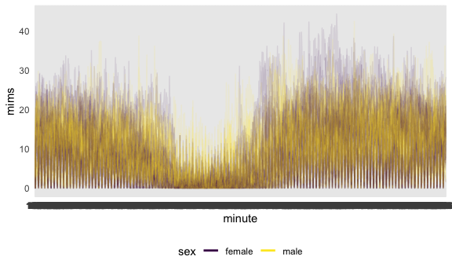

## Three-panel plot that shows the 24-hour activity time courses for “High school equivalent” group

``` r
nhanes_df |>
  filter(education == "High school equivalent") |>
  ggplot(aes(x = minute, y = mims, color = sex)) +
  geom_line(aes(group = seqn), alpha = .1) +
  geom_smooth(se = FALSE)
```

    ## `geom_smooth()` using method = 'loess' and formula = 'y ~ x'

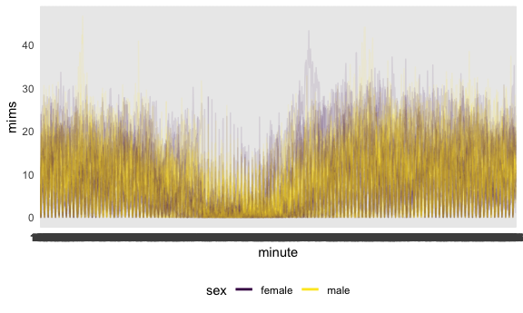

## Three-panel plot that shows the 24-hour activity time courses for “More than high school” group

``` r
nhanes_df |>
  filter(education == "More than high school") |>
  ggplot(aes(x = minute, y = mims, color = sex)) +
  geom_line(aes(group = seqn), alpha = .1) +
  geom_smooth(se = FALSE)
```

    ## `geom_smooth()` using method = 'loess' and formula = 'y ~ x'

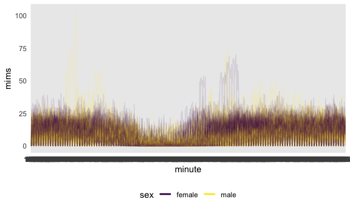

# Problem 3

## Importing and cleaning the datasets

``` r
jan_2020_df =
  read_csv("data/citibike/Jan 2020 Citi.csv") |>
  janitor::clean_names()|>
  mutate(year = 2020, month = "January")
```

    ## Rows: 12420 Columns: 7
    ## ── Column specification ────────────────────────────────────────────────────────
    ## Delimiter: ","
    ## chr (6): ride_id, rideable_type, weekdays, start_station_name, end_station_n...
    ## dbl (1): duration
    ## 
    ## ℹ Use `spec()` to retrieve the full column specification for this data.
    ## ℹ Specify the column types or set `show_col_types = FALSE` to quiet this message.

``` r
july_2020_df =
  read_csv("data/citibike/July 2020 Citi.csv") |>
  janitor::clean_names()|>
  mutate(year = 2020, month = "July")
```

    ## Rows: 21048 Columns: 7
    ## ── Column specification ────────────────────────────────────────────────────────
    ## Delimiter: ","
    ## chr (6): ride_id, rideable_type, weekdays, start_station_name, end_station_n...
    ## dbl (1): duration
    ## 
    ## ℹ Use `spec()` to retrieve the full column specification for this data.
    ## ℹ Specify the column types or set `show_col_types = FALSE` to quiet this message.

``` r
jan_2024_df =
  read_csv("data/citibike/Jan 2024 Citi.csv") |>
  janitor::clean_names()|>
  mutate(year = 2024, month = "January")
```

    ## Rows: 18861 Columns: 7
    ## ── Column specification ────────────────────────────────────────────────────────
    ## Delimiter: ","
    ## chr (6): ride_id, rideable_type, weekdays, start_station_name, end_station_n...
    ## dbl (1): duration
    ## 
    ## ℹ Use `spec()` to retrieve the full column specification for this data.
    ## ℹ Specify the column types or set `show_col_types = FALSE` to quiet this message.

``` r
july_2024_df =
  read_csv("data/citibike/July 2024 Citi.csv") |>
  janitor::clean_names()|>
  mutate(year = 2024, month = "July")
```

    ## Rows: 47156 Columns: 7
    ## ── Column specification ────────────────────────────────────────────────────────
    ## Delimiter: ","
    ## chr (6): ride_id, rideable_type, weekdays, start_station_name, end_station_n...
    ## dbl (1): duration
    ## 
    ## ℹ Use `spec()` to retrieve the full column specification for this data.
    ## ℹ Specify the column types or set `show_col_types = FALSE` to quiet this message.

## Total number of rides in each combination of year and month separating casual riders and Citi Bike members

``` r
bind_rows(jan_2020_df, july_2020_df, jan_2024_df, july_2024_df) |>
  count(year, month, member_casual) |>
  pivot_wider(
    names_from = member_casual,
    values_from = n
  ) |>
  knitr::kable()
```

| year | month   | casual | member |
|-----:|:--------|-------:|-------:|
| 2020 | January |    984 |  11436 |
| 2020 | July    |   5637 |  15411 |
| 2024 | January |   2108 |  16753 |
| 2024 | July    |  10894 |  36262 |

## Table showing the 5 most popular starting stations for July 2024

``` r
july_2024_df |>
  count(start_station_name) |>
  arrange(desc(n)) |>
  head(5) |>
  knitr::kable()
```

| start_station_name       |   n |
|:-------------------------|----:|
| Pier 61 at Chelsea Piers | 163 |
| University Pl & E 14 St  | 155 |
| W 21 St & 6 Ave          | 152 |
| West St & Chambers St    | 150 |
| W 31 St & 7 Ave          | 146 |

## Investigating the effects of day of the week, month, and year on median ride duration

``` r
median_df =
  bind_rows(jan_2020_df, july_2020_df, jan_2024_df, july_2024_df) |>
  group_by(year, month, weekdays) |>
  summarize(median_duration = median(duration)) |>
  mutate(year = as.character(year))
```

    ## `summarise()` has regrouped the output.
    ## ℹ Summaries were computed grouped by year, month, and weekdays.
    ## ℹ Output is grouped by year and month.
    ## ℹ Use `summarise(.groups = "drop_last")` to silence this message.
    ## ℹ Use `summarise(.by = c(year, month, weekdays))` for per-operation grouping
    ##   (`?dplyr::dplyr_by`) instead.

``` r
median_df |>
  ggplot(aes(x = weekdays, y = median_duration, color = month, shape = year)) +
  geom_point()
```

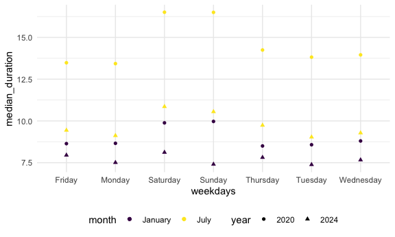

## Impact of month, membership status, and bike type on the distribution of ride duration

``` r
bind_rows(jan_2024_df, july_2024_df) |>
  mutate(rider_bike = paste(member_casual, rideable_type)) |>
  ggplot(aes(x = duration, y = rider_bike, fill = month)) +
  geom_boxplot()
```

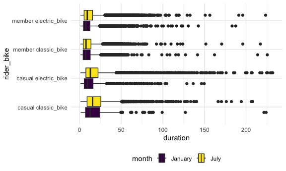
